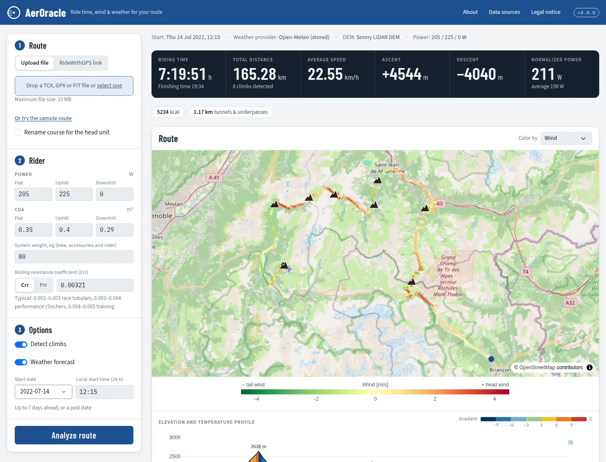

# AerOracle

**Ride time, wind and weather for your cycling route.** AerOracle estimates how long a route takes from your power,
weight and aerodynamics, using the best available elevation data and the weather forecast for your start time.
It runs as a web app or on the command line, and writes the course back as TCX, GPX and FIT for your head unit.



## What it does

- **Physics model** after Martin et al. (1998): power, system weight, drag area (CdA), rolling resistance
  (Crr, or Prr from bicyclerollingresistance.com), gravity, air density and wind. Power and CdA can differ
  between flat, uphill and downhill sections (gradient threshold `--gradient`, default 5 %).
- **Elevation** from the most detailed model covering each point: swissALTI3D, Sonny's LiDAR DTMs, Copernicus
  DEM, ALOS AW3D30, EU-DEM, ASTER GDEM, SRTM. Elevations in tunnels and on bridges are corrected with
  OpenStreetMap data, so the profile doesn't dive into valleys or climb over mountains.
- **Weather** along the route at the time you pass: wind (head, tail, cross), temperature, precipitation and
  UV index from Open-Meteo, Visual Crossing or meteoblue, with fallback to a second provider.
- **Climb detection** with summits added as course points, and summits moved to the actual high point.
- **What-if table**: how much faster or slower ±1 % in weight, power, CdA or Crr makes you.
- **Course export**: TCX, GPX and FIT; in FIT, course points keep their types (summit, climb categories,
  turns) instead of collapsing to TCX's limited set.

## Installation

Tested on Ubuntu 26.04 with Python 3.14.

1. System programs:
   ```sh
   sudo apt install gpsbabel gdal-bin    # GPX/FIT output; Copernicus DEM downloads
   sudo apt install osmctools            # Only for the OSM tools in tools/osm
   ```
2. [uv](https://docs.astral.sh/uv/) and the Python packages:
   ```sh
   git clone https://github.com/SARcycle/AerOracle.git aeroracle && cd aeroracle
   uv sync --extra web                   # Command line and web app
   ```
   Further extras: `dashboard` (usage statistics), `monitoring` (resource use of API calls),
   `tools` (OSM maintenance scripts), or `--all-extras`.
3. Settings and credentials:
   ```sh
   cp config.example.toml config.toml              # Set data_dir, see "Data"
   cp credentials.example.json credentials.json    # Fill in what you need, see below
   ```
4. Check what is available:
   ```sh
   uv run python main.py --check-data
   ```

`config.toml` and `credentials.json` are local files and never part of the repository. Every setting can
also be given as an environment variable, see [config.example.toml](config.example.toml).

### Credentials

All entries are optional; `--check-data` shows which are set.

| Entry | Needed for | Where to get it |
|---|---|---|
| `RWGPS` | RideWithGPS links: `username` = API key, `password` = auth token | [RideWithGPS API](https://ridewithgps.com/api) |
| `USGS` | ASTER GDEM downloads | [NASA Earthdata login](https://urs.earthdata.nasa.gov/) |
| `Meteoblue` | meteoblue forecasts (key as `password`) | [meteoblue weather API](https://content.meteoblue.com/en/business-solutions/weather-apis) |
| `VisualCrossing` | Visual Crossing forecasts (key as `password`) | [Visual Crossing](https://www.visualcrossing.com/) |

Open-Meteo, the default weather provider, needs no key. Use one account per provider and respect its terms:
the free APIs of Open-Meteo and meteoblue are for non-commercial use only.

## Usage

### Web app

```sh
uv run python app.py          # Development server on http://127.0.0.1:8050
```

For a server, run it with gunicorn behind a reverse proxy (nginx, Caddy). Keep a single worker: running
analyses and their progress live in the worker's memory.

```sh
uv run gunicorn app:server --workers 1 --threads 4 --timeout 600 --bind 127.0.0.1:8050
```

The start page offers an example route (Tour de France 2022, stage 12) with stored weather, so it can be tried
without any data or API key. If you run a modified version for others, set `source_url` in `config.toml`: the
AGPL requires offering the source code to the users of a web service.

### Command line

```sh
uv run python main.py -i route.tcx -t 2026-07-14T09:00 -k
```

| Option | Meaning | Default |
|---|---|---|
| `-i`, `--input` | Route file (TCX, GPX, FIT). A bare file name is looked up in `input_dir` | required |
| `-u`, `--url` | RideWithGPS route or trip link (saved as the input file name) | |
| `-t`, `--time` | Start time, local; enables the weather forecast (up to 7 days ahead) | no weather |
| `-p`, `--power` | Power in W: flat, uphill, downhill | 210, 231, 0 |
| `-m`, `--powerfactor` | Uphill power = flat power × factor, if only one power is given | 1.1 |
| `-w`, `--weight` | System weight (rider and bike) in kg | 80 |
| `-c`, `--cda` | Drag area in m²: flat, uphill, downhill | 0.38, 0.40, 0.29 |
| `-b`, `--tt` | Time trial bike (CdA 0.23) | |
| `-r`, `--crr` | Rolling resistance coefficient | 0.00321 |
| `-g`, `--gradient` | Gradient threshold for uphill/downhill power and CdA | 0.05 |
| `-a`, `--weather` | Weather provider: `o` Open-Meteo, `m` meteoblue, `v` Visual Crossing | `o` |
| `-k`, `--climbs` | Detect climbs and add them as course points | |
| `-q`, `--quiet` | Less output | |
| `--check-data` | Report available data, credentials and programs | |

The course is written as TCX next to the input (the input file is replaced), plus GPX and FIT, and with
`-t` a wind chart (`<route>_meteo.jpeg`). With `publish_dir` and `publish_url` set in `config.toml`, these
files are moved to a web server folder and their links printed.

### Usage statistics

`tracker.py` logs each analysis (time, distance, elevation gain) and each weather API call in `usage.db`;
no routes, no personal data, no IP addresses.
`dashboard.py` shows them:

```sh
uv sync --extra web --extra dashboard
uv run streamlit run dashboard.py
```

## Data

AerOracle reads its data from `<data_dir>/GeoData`. **Every data set is optional**: without it, the next
elevation model takes over (finally SRTM, downloaded automatically), or the correction is skipped. With an empty
data folder, AerOracle works with SRTM alone, at the cost of a less accurate profile and no tunnel or bridge
corrections.

```
GeoData/
├── DEM/
│   ├── swisstopo/      swissALTI3D_5m_elevation_r2023_10xuint16_compressed_DEFLATE.tif   manual
│   │                   swissBOUNDARIES3D_1_3_TLM_LANDESGEBIET_Simplified.shp (+ .shx .dbf .prj)
│   ├── SonnyDEM/       N46E008.tif … (1°×1° tiles), SonnyDEM_Tiles_Outline_Singlepart.shp   manual
│   ├── CopernicusDEM/  Copernicus_DSM_COG_10_N46_00_E008_00_DEM_10xInt32.tif …          automatic
│   ├── ALOS/           ALPSMLC30_N046E008_DSM.tif …                                      automatic
│   ├── EUDEM/          EUDEM_Boundaries_Singleparts.shp (manual), eudem_dem_5deg_*.tif    automatic
│   ├── ASTER/          ASTGTMV003_N46E008_dem.tif …                                       automatic (USGS login)
│   └── SRTM3/          N46E008.hgt …                                                      automatic
├── Gravimetry/         WGM2012_Freeair_ponc_2min_mgal_Int16_LZW.tif                       manual
└── OSM/
    ├── countries/tunnels/   *_MultiPoly.shp     tools/osm/osm_tunnels_world.py
    ├── countries/bridges/   *_MultiPoly.shp     tools/osm/osm_tunnels_world.py
    └── outlines/            *_MultiPoly.shp     tools/osm/osm_tunnels_world.py
```

Automatic tiles are downloaded the first time a route needs them and kept for later routes.

**Manual data sets**, prepared once:

- **swissALTI3D** (Switzerland): a mosaic of the [swissALTI3D](https://www.swisstopo.admin.ch/en/height-model-swissalti3d)
  tiles at 5 m resolution, in LV95 (EPSG:2056), elevation × 10 stored as UInt16, DEFLATE compressed (about 1.4 GB).
  The Swiss border comes from [swissBOUNDARIES3D](https://www.swisstopo.admin.ch/en/landscape-model-swissboundaries3d)
  (national territory, simplified).
- **Sonny's LiDAR DTMs** (parts of Europe): the 1°×1° GeoTIFF tiles from [sonny.4lima.de](https://sonny.4lima.de/),
  named like `N46E008.tif`, plus a shapefile (EPSG:4326) outlining the area they cover.
- **EU-DEM**: a shapefile (EPSG:4326) of the area covered by [EU-DEM](https://land.copernicus.eu/imagery-in-situ/eu-dem);
  the tiles themselves are downloaded automatically from Eurostat GISCO.
- **WGM2012** gravity: the 2′ free-air anomaly grid of the [World Gravity Map](https://doi.org/10.18168/bgi.23)
  (in mGal), as an Int16 GeoTIFF in EPSG:4326. Its effect on the riding time is small.
- **OpenStreetMap tunnels and bridges**: `tools/osm/osm_tunnels_world.py` downloads the
  [Geofabrik](https://download.geofabrik.de/) extracts one at a time (per state or region where Geofabrik offers
  them, otherwise per country), filters tunnels and bridges on roads and cycleways, and buffers them into
  polygons. It needs the `tools` extra, osmctools and GDAL, and runs for hours. Since each extract is deleted
  once processed, it needs little temporary space; run it monthly, for example from cron.
  `tools/osm/osm_manager.sh` shows the status of the OSM data and restores archived versions.

## Data sources

The data sets are not part of this repository and have their own licences. These credits are also shown in the
web app ("Data sources") and must stay visible in any service using the data:

- **Open-Meteo**: weather data by [Open-Meteo.com](https://open-meteo.com/), [CC BY 4.0](https://creativecommons.org/licenses/by/4.0/).
  The example weather (`examples/tdf2022_stage12_weather.json`) is from the Open-Meteo historical weather API.
- **Visual Crossing**: weather data provided by [Visual Crossing](https://www.visualcrossing.com/).
- **meteoblue**: weather data by [meteoblue](https://www.meteoblue.com/).
- **swissALTI3D, swissBOUNDARIES3D**: source: Federal Office of Topography swisstopo.
- **Sonny's LiDAR DTMs**: by Sonny, [sonny.4lima.de](https://sonny.4lima.de/), [CC BY 4.0](https://creativecommons.org/licenses/by/4.0/).
- **Copernicus DEM GLO-30**: produced using Copernicus WorldDEM-30 © DLR e.V. 2010-2014 and © Airbus Defence and
  Space GmbH 2014-2018 provided under COPERNICUS by the European Union and ESA; all rights reserved.
- **ALOS World 3D - 30 m (AW3D30)**: © JAXA.
- **EU-DEM**: produced using Copernicus data and information funded by the European Union - EU-DEM layers.
- **ASTER GDEM V003**: NASA/METI/AIST/Japan Spacesystems and U.S./Japan ASTER Science Team (2019),
  [doi:10.5067/ASTER/ASTGTM.003](https://doi.org/10.5067/ASTER/ASTGTM.003).
- **SRTM**: NASA Shuttle Radar Topography Mission, public domain.
- **WGM2012**: Bonvalot, S. et al. (2012), World Gravity Map, BGI, CGMW, CNES, IRD,
  [doi:10.18168/bgi.23](https://doi.org/10.18168/bgi.23).
- **OpenStreetMap**: map tiles and tunnel/bridge data © [OpenStreetMap contributors](https://www.openstreetmap.org/copyright),
  data available under the Open Database License (ODbL). Tunnel and bridge shapefiles you generate are derived
  databases under the ODbL. The web app's map uses the OpenStreetMap tile servers; heavy use must follow the
  [tile usage policy](https://operations.osmfoundation.org/policies/tiles/).
- **Example route**: Tour de France 2022, stage 12 (Briançon - Alpe d'Huez), from [RideWithGPS](https://ridewithgps.com/).

## Scientific basis

Martin, J. C., Milliken, D. L., Cobb, J. E., McFadden, K. L., & Coggan, A. R. (1998). Validation of a
Mathematical Model for Road Cycling Power. *Journal of Applied Biomechanics*, 14(3), 276-291.
[doi:10.1123/jab.14.3.276](https://doi.org/10.1123/jab.14.3.276)

## History

AerOracle was conceived and developed by SARcycle, starting in 2015 with a first version in MATLAB. It moved to
Python around 2018 and was refactored, with a first web front end, in 2025. The 2026 refactoring (Python 3.14,
polars, vectorised solver) and the current web front end were written with help from AI.

## Licence

Copyright © 2015–2026 SARcycle

AerOracle is free software under the [GNU Affero General Public License, version 3 or later](LICENSE), with
two additional terms (see [NOTICE](NOTICE)): copies and modified versions with a user interface must keep the
attribution "AerOracle by SARcycle" (or "Based on AerOracle by SARcycle") with a link to the source code, and
modified versions must be marked as such. Running a modified version as a web service means offering its source
code to its users.

Included third-party files: Bootstrap (MIT License), and the fonts Barlow Condensed, Source Sans 3 and
IBM Plex Mono (SIL Open Font License 1.1, texts in [dash_assets/fonts](dash_assets/fonts)).
